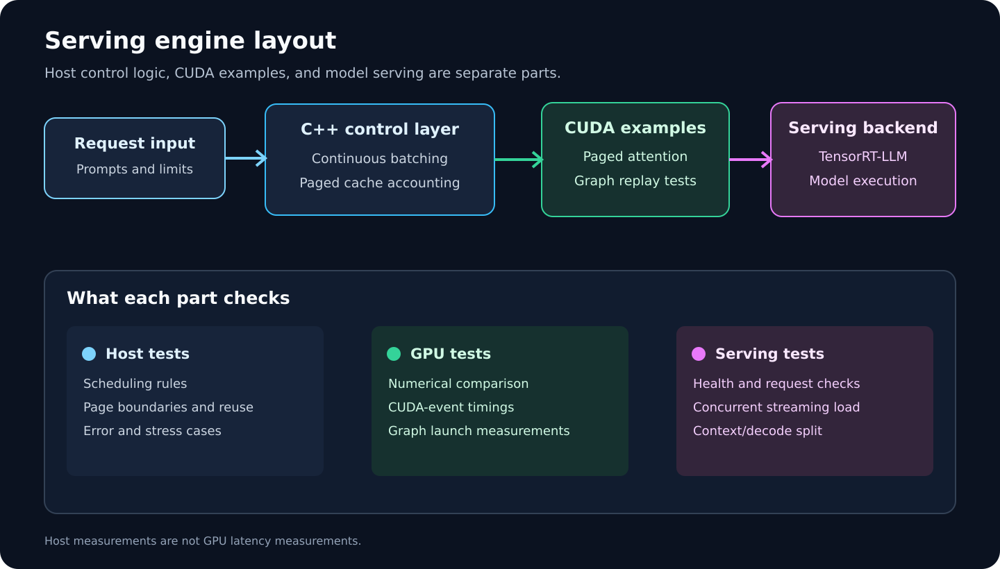
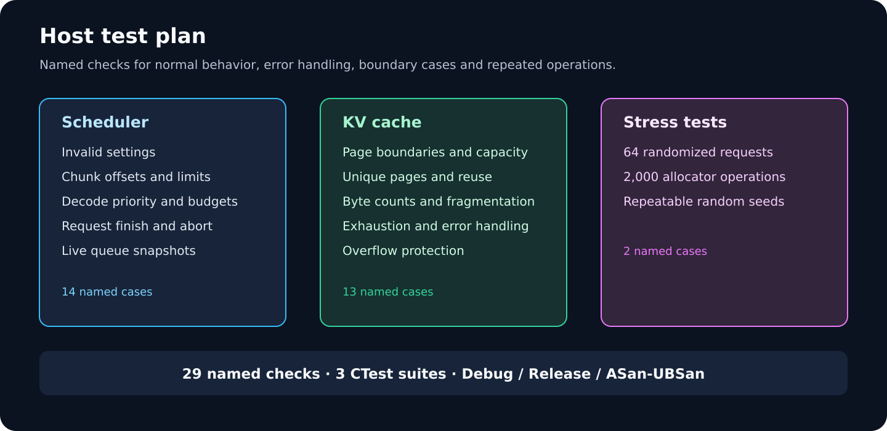
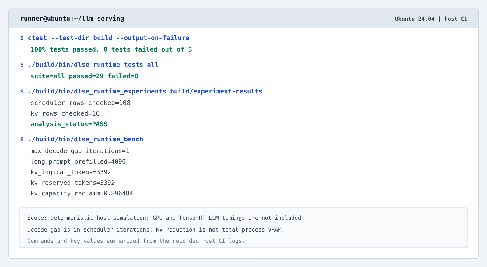
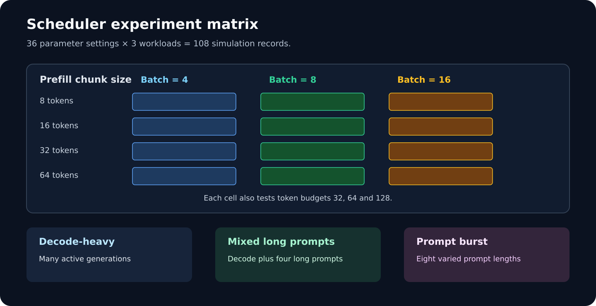
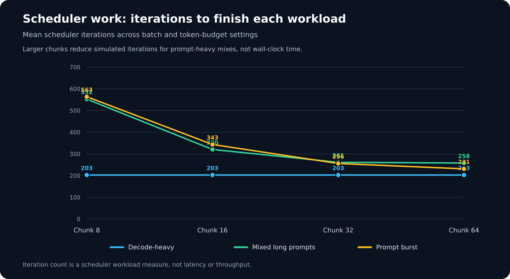
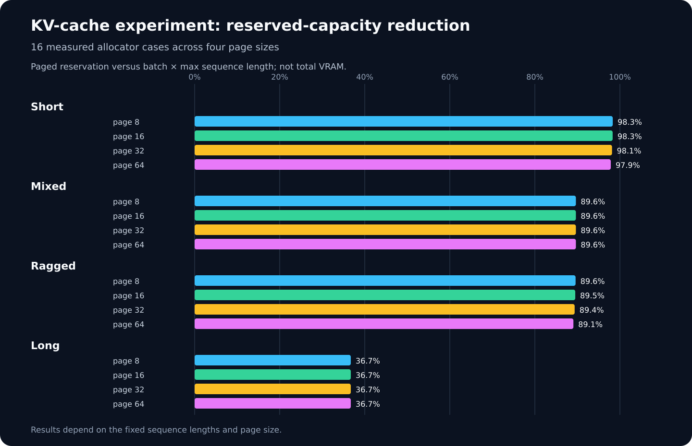
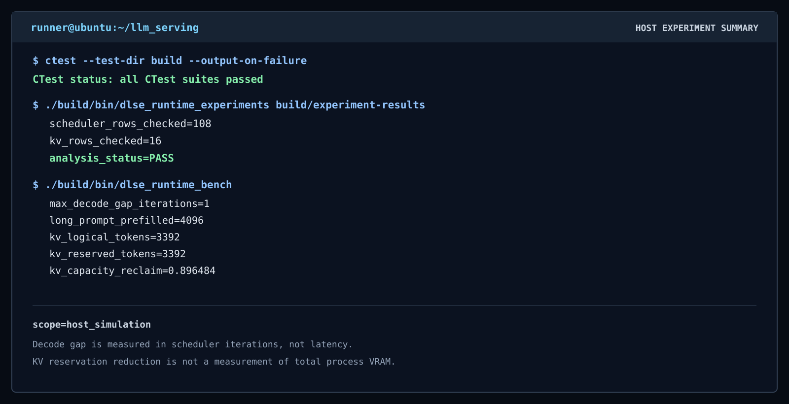
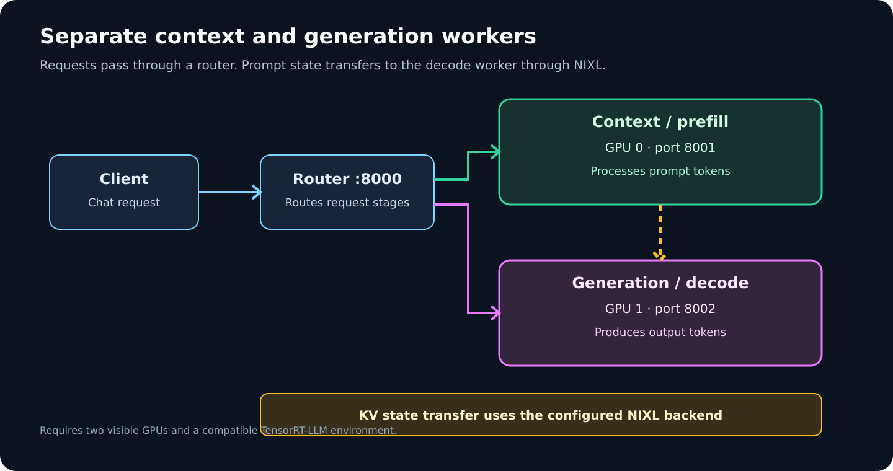

# Disaggregated LLM Serving Engine

Maintainer: **Pirate-Emperor**

A serving-engine study built around a C++20 scheduling core, paged KV-cache accounting, CUDA experiments, and TensorRT-LLM serving examples. The host-side scheduler and allocator can be built and tested without a GPU. CUDA and TensorRT-LLM tests need a compatible NVIDIA system.

Host measurements are shown separately from GPU measurements. GPU performance claims are not described as measured until the exact workload has been run on the target hardware.

## Design

The project has four main parts:

- **Continuous batching:** keeps prefill work in bounded chunks and schedules active decode requests first.
- **Paged KV cache:** maps each sequence to physical pages and reports reserved capacity, logical use, bytes, and internal fragmentation.
- **CUDA experiments:** compares contiguous and paged attention output and measures ordinary launch submission against CUDA Graph replay.
- **TensorRT-LLM examples:** provides aggregated and separate context/generation server configurations, smoke tests, and load tests.

The C++ scheduler and allocator are host-side reference components. They do not replace the scheduler or device-memory allocator inside TensorRT-LLM. The CUDA attention kernel is a correctness-first example, not a claim of production-level attention speed.

## Repository layout

| Path | Purpose |
| --- | --- |
| dlse_runtime/include/dlse/runtime.h | Scheduler and KV-cache interfaces |
| dlse_runtime/src/runtime.cpp | Scheduling rules and page allocator |
| dlse_runtime/tests/runtime_tests.cpp | Unit, boundary, error and randomized tests |
| dlse_runtime/benchmarks/runtime_bench.cpp | Reproducible host benchmark |
| dlse_runtime/benchmarks/runtime_experiments.cpp | Parameter sweeps and KV-cache study |
| dlse_runtime/cuda/paged_attention.cu | Contiguous and paged CUDA decode kernels |
| dlse_runtime/benchmarks/paged_attention_bench.cu | CUDA output comparison and timing |
| dlse_runtime/benchmarks/cuda_graph_bench.cu | CUDA Graph launch-submission experiment |
| dlse_runtime/python/ | TensorRT-LLM adapter and verification entry point |
| dlse_runtime/configs/ | Aggregated and disaggregated settings |
| dlse_runtime/scripts/ | Build, server, metric and benchmark helpers |
| dlse_runtime/docs/ | Design, deployment and measurement notes |
| docs/assets/ | Architecture, terminal and experiment figures |

## Requirements

### Host build and tests

- CMake 3.20 or newer
- A C++20 compiler
- Bash for helper scripts
- Python 3 for repository checks and experiment charts

The host workflow runs on Linux and does not require CUDA.

### GPU experiments

The CUDA examples additionally require an NVIDIA GPU, a compatible driver and CUDA toolkit with nvcc. Set the CUDA architecture to match your device. The examples below use 86 for an RTX 3090; use 80 for A100.

TensorRT-LLM examples require a supported software combination and enough GPU memory for the selected model. The container scripts use the 1.3.0rc29 development or runtime image.

## Quick start

Clone the default branch:

~~~bash
git clone https://github.com/SpryzenHell/llm_serving.git
cd llm_serving
~~~

Build, run the C++ tests, and run the host benchmark:

~~~bash
cmake -S . -B build -DCMAKE_BUILD_TYPE=Release
cmake --build build --parallel
ctest --test-dir build --output-on-failure
./build/bin/dlse_runtime_bench
~~~

The same checks are available through make test and make dlse-bench.

## Tests

The C++ test executable runs named checks grouped into three CTest suites:

| Suite | Coverage |
| --- | --- |
| Scheduler | Invalid limits, prefill offsets, chunk limits, round-robin admission, decode priority, output limits, cancellation and live queue counts |
| KV cache | Page boundaries, unique physical pages, byte accounting, fragmentation, page reuse, unknown IDs, exhaustion and overflow |
| Stress | Seeded randomized workloads that check scheduling and allocator rules over repeated operations |

Test conditions remain active in Release builds. The host CI workflow builds Debug and Release variants and runs a separate AddressSanitizer/UndefinedBehaviorSanitizer build.

Run one suite directly:

~~~bash
./build/bin/dlse_runtime_tests scheduler
./build/bin/dlse_runtime_tests kv
./build/bin/dlse_runtime_tests stress
~~~

Run every case in one process with ./build/bin/dlse_runtime_tests all.

## Host benchmark

The standard host benchmark admits eight decode requests, then adds one 4096-token prompt. It also measures page reservation for eight sequence lengths.

The recorded host reference output is:

| Measurement | Result |
| --- | ---: |
| Maximum decode gap in the simulation | 1 scheduler iteration |
| Long prompt scheduled | 4096 tokens |
| Logical KV tokens | 3392 |
| Reserved KV tokens | 3392 |
| Contiguous KV reservation | 128.00 MiB |
| Paged KV reservation | 13.25 MiB |
| Reduction in KV reservation | 89.6484% |

This is a deterministic host simulation. The decode-gap value is not GPU inter-token latency, and the KV result is not a measurement of total process VRAM.

## Parameter experiments and data analysis

Run the parameter sweep:

~~~bash
./build/bin/dlse_runtime_experiments dlse_runtime/results/experiments
python3 dlse_runtime/scripts/analyze_experiments.py dlse_runtime/results/experiments
~~~

The experiment runner validates schedules while sweeping:

- 3 decode batch limits: 4, 8 and 16;
- 3 token budgets: 32, 64 and 128;
- 4 prefill chunk sizes: 8, 16, 32 and 64;
- 3 request mixes: decode-heavy, mixed long prompts, and a prompt burst.

This gives 36 scheduler settings and 108 workload/settings records. Each record contains iteration count, prompt and decode tokens, maximum and percentile decode-gap measurements in **scheduler iterations**, mean prefill tokens per iteration and the largest prefill chunk. These are simulation measurements, not wall-clock latency.

The KV-cache sweep tests page sizes 8, 16, 32 and 64 over short, mixed, ragged and long sequences. It records logical tokens, reserved tokens, reserved bytes, equivalent contiguous reservation, reservation reduction and internal fragmentation. Both sweeps write CSV files. The analysis script checks the data and creates charts and a Markdown summary based on those CSV rows.

The detailed host results, including the parameter tables and findings, are in [Host experiment summary](dlse_runtime/docs/host_experiment_summary.md).

The measured row data is checked in for direct inspection: [scheduler sweep CSV](dlse_runtime/docs/data/host_scheduler_sweep.csv) and [KV-cache sweep CSV](dlse_runtime/docs/data/host_kv_cache_sweep.csv). The CI workflow also uploads each run's CSV files, logs, and generated charts as artifacts.

## CUDA build and experiments

On a CUDA-enabled host:

~~~bash
cmake -S . -B build-cuda \
  -DDLSE_ENABLE_CUDA=ON \
  -DCMAKE_BUILD_TYPE=Release \
  -DCMAKE_CUDA_ARCHITECTURES=86
cmake --build build-cuda --parallel
./build-cuda/bin/dlse_paged_attention_bench
./build-cuda/bin/dlse_cuda_graph_bench 10000
~~~

For the Makefile target, the CUDA architecture can be selected with CUDA_ARCH. For example, use the default 86 setting on an RTX 3090, or use 80 on an A100:

~~~bash
make dlse-cuda
CUDA_ARCH=80 make dlse-cuda
~~~

The same override works with the validation script and container entry points:

~~~bash
CUDA_ARCH=80 ./dlse_runtime/scripts/run_cuda_validation.sh
CUDA_ARCH=80 ./dlse_runtime/scripts/enter_trtllm_dev_container.sh
~~~

The paged-attention benchmark creates matching contiguous and paged key/value data, compares output values, and reports CUDA-event timings. The CUDA Graph benchmark uses device-resident state and a counter, compares repeated ordinary launches with graph replay, and reports host submission time per step.

The CUDA Graph result measures host enqueue overhead. It is not the same as GPU kernel execution time, total request latency or ITL. No CUDA timing figure is presented as measured until it has been run on a target GPU.

## TensorRT-LLM setup

The container helpers mount the repository into /workspace/llm_serving and mount the local cache directory.

~~~bash
./dlse_runtime/scripts/enter_trtllm_dev_container.sh
~~~

For server execution, use:

~~~bash
./dlse_runtime/scripts/enter_trtllm_runtime_container.sh
~~~

The scripts use these NVIDIA images:

- nvcr.io/nvidia/tensorrt-llm/devel:1.3.0rc29
- nvcr.io/nvidia/tensorrt-llm/release:1.3.0rc29

They require Docker access and a working NVIDIA Container Toolkit on the host. Confirm image availability and model compatibility on the target machine.

## Run a single serving endpoint

Inside a compatible TensorRT-LLM environment:

~~~bash
./dlse_runtime/scripts/run_trtllm_server.sh \
  TinyLlama/TinyLlama-1.1B-Chat-v1.0
~~~

Check readiness:

~~~bash
curl -fsS http://127.0.0.1:8000/health
~~~

Send an OpenAI-compatible request and verify its response:

~~~bash
./dlse_runtime/scripts/smoke_test.sh \
  TinyLlama/TinyLlama-1.1B-Chat-v1.0
~~~

The smoke test calls /health and sends one /v1/chat/completions request. It fails if the server is not ready or the request fails.

## Disaggregated context and generation

The separate worker scripts use GPU 0 for context/prefill and GPU 1 for generation/decode by default. Both workers need a valid NIXL transfer configuration and access to the same model. The setup expects two visible GPUs.

Start all three local processes:

~~~bash
./dlse_runtime/scripts/run_local_disaggregated.sh \
  TinyLlama/TinyLlama-1.1B-Chat-v1.0
~~~

The router listens on port 8000, the context worker on 8001, and the generation worker on 8002. Logs are written under logs/disaggregated/.

See dlse_runtime/docs/disaggregated_deployment.md for configuration and deployment notes.

## Serving measurements

Measure concurrent requests:

~~~bash
PYTHONPATH=dlse_runtime/python \
python3 dlse_runtime/benchmarks/trtllm_benchmark.py \
  --model TinyLlama/TinyLlama-1.1B-Chat-v1.0 \
  --requests 8 \
  --max-tokens 64
~~~

The benchmark records per-request TTFT and ITL, token counts, total time and aggregate throughput. It writes a JSON result file.

Run request counts 1, 2, 4 and 8:

~~~bash
./dlse_runtime/scripts/run_trtllm_matrix.sh \
  TinyLlama/TinyLlama-1.1B-Chat-v1.0
~~~

For baseline-versus-optimized settings:

~~~bash
./dlse_runtime/scripts/run_serve_ab.sh \
  TinyLlama/TinyLlama-1.1B-Chat-v1.0
~~~

That test compares a combined configuration change: chunked prefill, KV block reuse and decode graph buckets. It does not isolate one feature's contribution. Results are written under dlse_runtime/results/serve_ab/.

Before comparing serving numbers, keep the model checkpoint, tokenizer, input distribution, output length, GPU, software version, quantization and parallelism fixed. Save the environment record and raw JSON beside the result.

## Reading the measurements correctly

| Statement | Evidence needed |
| --- | --- |
| Bounded inter-token latency | Target-GPU ITL p50/p95/p99 for mixed prompts and decode load |
| Throughput multiplier | Identical-workload baseline and optimized token/s results |
| KV memory reduction | Same workload and model with measured KV allocation; separate this from total-process VRAM |
| Kernel-launch latency | Specify host enqueue time or device execution time; do not mix them |

The resume targets of 8x throughput, more than 60% VRAM recovered, and below 2 microseconds launch latency are not reported as measured results here. Use those values only if matching target-hardware measurements support them.

## Development checks

~~~bash
make test
make dlse-bench
make dlse-experiment
~~~

For host checks with runtime sanitizers:

~~~bash
cmake -S . -B build-sanitize \
  -DCMAKE_BUILD_TYPE=Debug \
  -DDLSE_ENABLE_SANITIZERS=ON
cmake --build build-sanitize --parallel
ctest --test-dir build-sanitize --output-on-failure
~~~

The GitHub Actions workflow tests Debug, Release and sanitizer builds. It also runs the host benchmark, checks shell/Python syntax, validates repository figures, and saves experiment logs and CSV files as run artifacts.

## Maintainer

Pirate-Emperor
